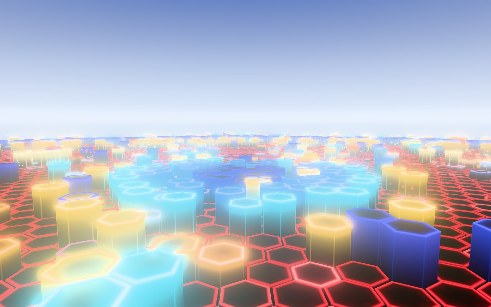
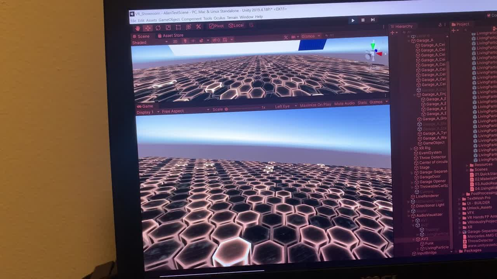
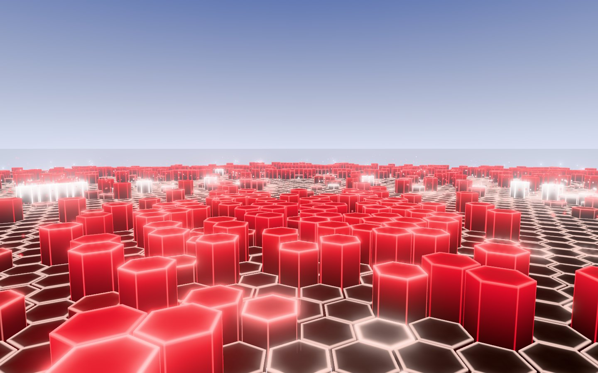

# Living Particles 3JS

Particle studies for the browser, translated from Unity VFX Graph and TouchDesigner.

**Study 01 · Hex Field** rebuilds a Unity test from a few years ago: a floor of hex particles from SineVFX's [Living Particles](https://assetstore.unity.com/packages/vfx/particles/spells/living-particles-105817) pack, driven by an FFT script so each part of the floor answers its own frequency band (inspired by *Tetris Effect*). It is one instanced draw call of about 7,400 hex prisms, a spark system and a plume gesture with real lifetimes, two editable looks you can mix, and a music library for bringing in Daydream sketches and stems.

**v0.2 · Precision pass** (branch `study-01-precision-pass`) follows the [development spec](https://app.notion.com/p/4121f16ba96281ff9f04f57fd9f2b046): separately controlled light terms, an editor grouped by what you change, analysis of decoded tracks ahead of playback with timestamped hits, finite particle budgets, a composed Plume phrase, and an experimental harmony → shimmer response.

**v0.3 · Composed motion** (branch `study-01-composed-motion`) follows the [v0.3 plan](https://app.notion.com/p/4161f16ba96281389159f718d93137af): a repaired history, one bar for performing and an editor that shows one family at a time, colour ramps and a received light, and an authored score of calls and replies above the measured music. See *What v0.3 changes*.



| Unity capture (AV3 · Funk) | This study (AV3 · Funk) |
|---|---|
|  |  |

## Run it

ES modules, the analysis worker and the microphone need a local server:

```
npx http-server . -c-1
```

On Windows PowerShell use `npx.cmd http-server . -c-1`. Then open http://127.0.0.1:8080. Use the same address every time: the music library lives in that address's browser storage.

No build step. three.js 0.186.0 loads from jsDelivr through the import map in `index.html`.

## Using it

- **The bar** (top) is the one place for what you reach for while it plays:
  - *Source*: what is playing and how it is analysed. Click it (or **L**) for **Music**: Pattern (built-in test music), Track, Mic, or Stress (the old synthetic spectrum, visual only). Drop audio anywhere on the page. Tracks stay in this browser (IndexedDB) and are never uploaded. A track is analysed in a worker when it is first played; the bar says *precise* when that is done (*basic* until then).
  - *Transport*: play / pause, restart, loop, time.
  - *Scene*: choose a scene (built in, saved, or saved with a track). **Revert** lights up once anything differs from the scene as loaded or last saved. **Save…** stores it under a name or with the playing track, and holds Export / Import JSON and Reset.
  - *A / Mix / B* and the mix fader.
  - *Three macros*, each scaling one thing: **Movement** (× maximum lift), **Activity** (× particle budgets), **Light** (× the light the tiles give off; glow is separate).
- **Edit** (**E**) opens the editor, one family at a time: **Looks** (which world), **Motion** (how it travels), **Activity** (how much happens), **Light** (how the form reads), **Music response** (what the music can move), **Inspect** (why something happens). Looks and Light edit one look, A or B; the header says which and warns when that look is not on screen. Every number can be typed with its unit, nudged with the arrow keys, and reset (double-click a label). A greyed control says why it has no effect right now.
- **Music response**: one mapping at a time. With this family or Inspect open, the meters under the floor show the mapping as *measured* (dB) → *processed* (after gate and normalisation) → *output* (what the floor gets). **Inspect** holds **Solo response**, **Manual test** (a level, a hit, or full harmony confidence injected after the detector) and the render views.
- **Score** (Edit › Motion, off unless a scene turns it on; try the built-in scene *Call and reply*): authored gestures above the measured music. A slow **foundation** swell, a **call** that crosses the floor on one of three routes, and a **reply** that leaves from where the call arrived and climbs away. Tempo is set by hand, with **Tap** to put beat 1 where you hear it; nothing is inferred from loudness. The music can add weight to a gesture up to the amount you set, and no further. *Clock*: **Loop** puts every call exactly on the grid (the same after any seek; the score repeats, so a loop can be captured); **Free** lets the music bend the pace a little without ever jumping.
- **Plume entry** (Edit › Motion › Plume): on every hit of a voice, only when cued (**C**), or once per call as its reply. The limit on plumes alive at once applies to all three.
- **Light path** (Edit › Light) can ride the call: the received light sits on the call's front and goes dark between calls.
- **Floor**: move the pointer over it (the hands in the Unity capture).
- **Camera**: drag to orbit, scroll to zoom. **1** Stand · **2** Survey · **3** Low.
- **Space** play/pause · **R** restart · **C** cue a plume · **E** editor · **L** music · **H** hide everything · **Esc** closes whatever is open. Keys never fire while you type in a field.
- **Scenes** hold every control, both looks and the camera, and load as a whole: anything an older scene never had takes its default, whatever was on screen before. A scene saved with a track comes back when that track starts (*Recall*, in Music). Scenes from v0.1 and v0.2 load as before; a scene from a newer build is refused with a message.

## What v0.3 changes

| Checkpoint | What changed | Evidence |
|---|---|---|
| P0 · Repaired baseline | The rim (b) and colour (a) history writes in `src/response.js` sat behind a line comment at `28e8c16`, so **rim breath** and **colour drift** never reached the floor while their meters moved. Restored. Also: a fall time of 0 ms is instant instead of NaN. | `node tools/history.test.mjs` (9 checks on what each history channel means); `capture.py check` item 8 (the two channels reach the picture); `docs/composed-motion/p0_before_vs_repaired.jpg` |
| P1 · Interface | One bar instead of five panels: a single transport and a single A / Mix / B. The editor shows one family at a time. Meters appear only with the families that use them. Named scenes, Revert, and an "edited" state. The **Light** macro is new (× emission); **Activity** is the old Sparks macro, now named for everything it scales. | `python tools/flow.py` (the first-use path with real clicks and keys at 1440 and 390 px); `docs/composed-motion/p1_interface_*.jpg` |
| P2 · Looks and light | **Colour by role**: a look can colour tiles from two ramps instead of eight voice colours. The *body* ramp places a lit tile by its voice's level (shadow → body → crest), with low voices kept in the deep end; the *accent* ramp colours events (hits, sparks, plume). One fader, *Colour from*, runs from voices to ramps. **Received light**: one local light that faces and sides receive by their normals; it is not emission, so it does not feed the glow. Two looks use both: **Mineral Night** (compare with Nocturne) and **Daylight Precision** (compare with AV2 · Precision); each has a built-in scene with the look it answers in B. Every earlier look renders exactly as before. Ramps export and import as palette files (`palettes/`). | `node tools/palette.test.mjs` (9); `python tools/looks_check.py` (8); `docs/composed-motion/p2_*.jpg` |
| P3 · Composed response | An **authored score** above the measured music (`src/shared/score.js`): foundation, call, reply, each with its own rise, crest, release and rest, on a tempo set by hand. A reply is created with its call, carries its id and strength, and starts a set delay later: one call, one answer. The hex field draws them on three routes authored for the Stand camera (`src/world/gestures.js`): calls cross the middle ground, replies climb away; a tile takes the gesture's envelope at the nearest place on the route, so it lights as the front passes and settles on its own. Calls take the accent ramp, replies the pale end of the body ramp. **Plume entry** has three modes to compare (every hit · cued · once per call). The received light can ride the call. Loading a scene now starts from defaults, so an older scene cannot inherit a newer setting from whatever was loaded before. Schema 9; the score is off in every earlier scene, which render exactly as before. | `node tools/score.test.mjs` (13); `python tools/score_check.py` (9); `docs/composed-motion/p3_*` (stills, a timing chart of the three plume modes, and a 12 s clip, score off beside score on) |

## What v0.2 changed

| Area | Now |
|---|---|
| Light | Each contribution is its own control: resting rim, rim breath, rim response, inner spill, interior fill, side glow and falloff, top line, corner lines, hit accent (coloured), hit whitening (white), spark white core. Bloom is fed by an emission-only render with real occlusion, so the sky does not glow unless you ask (`bloomSky`). Distant rims fade by coverage instead of merging into a sheet. Diagnostic views: no glow, glow only, emission only, surfaces only. |
| Looks | The four originals are kept as authored. **AV2 · Precision** was tuned with bloom off first: coloured rims, dark interiors, no white flash, glow 0.2 / spread 0.25 / cutoff 1.1. |
| A / B | Preview A, Mix, Preview B is separate from which look you edit, so editing B at mix 0 is never invisible. |
| Audio | Tracks and the pattern are analysed from decoded PCM ahead of playback (below). Musical time comes from the audio clock, unwrapped across loops; the same audio time gives the same rows, hits and spark births at any frame rate. |
| Hits | Events with an id, time and strength. One hit = one finite spark budget, with births scheduled along the ripple. Overflow is counted, not hidden. |
| Plume | One authored gesture per hit on a chosen voice: emerge, rise, curl, disperse, rest (0–80 / 80–250 / 250–900 / 900–1600 ms at length 1.6 s), at most N at once. |
| Harmony | Experimental: a held fifth between two detected notes makes the rims twinkle. Off by default. |
| Scenes | Schema 6. Study 01 saves (schema 1) migrate step by step; nothing is discarded. Imports are validated (finite numbers, valid ranges, floor < ceiling). |

## Pieces another sketch can take

`src/shared/` holds modules with no three.js and no app state, written to be copied into Audio Geology or a new world (see `src/shared/README.md` for what each one promises and what stays local to a world).

| Module | What it is | First consumer here |
|---|---|---|
| `palette.js` | Colour ramps as a small versioned asset: stops with stable names, sRGB in, linear out, bake to a strip, mix two palettes, check a file. | `looks.js` (two ramps per look), `world/ramptex.js` (the texture) |
| `score.js` | Authored gestures on a musical clock: calls and the replies that answer them (ids, parents, start times, envelopes), a foundation swell, a loop clock that is exact and a free clock that bends, bounded weighting by a measured level, reset and long-gap behaviour. | `world/gestures.js` (this floor's routes), `world/hexfield.js` (the shader), `main.js` (plume per reply, light on the call) |

Palette files live in `palettes/`. `palettes/stellar-tide-court.take-a.json` is not used by this floor: it is the Court study's palette, sampled by region from three frames of its Take A clip with `tools/sample_palette.py` (the boxes and frame times are in `palettes/sources/`, the sheet is `docs/composed-motion/court_palette_take_a.jpg`). Its stops are the raw samples and have not been art-directed: the inlay ramp does not get steadily lighter, and the stone ramp is very dark. A world decides what a ramp's position means: here a tile's level; in Audio Geology it could be a ribbon's age; in the Stellar Tide Court study, height along a branch. The score hands out gesture instances and knows nothing about geometry: a world supplies its own routes (here arcs and rays on the floor; in Audio Geology two ribbon groups; in the Court, the inlay paths and the branches). `tools/score.test.mjs` includes a check that draws the same score on two straight ribbons.

Not extracted yet: the response envelopes and the history writer (`src/response.js`) still read this app's settings directly. Their channel layout and reset behaviour are pinned by `tools/history.test.mjs`; passing the settings in is the step that makes them portable.

## Audio analysis

Measurement, interpretation and mapping are kept apart: tuning a visual never changes a measured value or a hit's time.

| Path | Window / hop | At 48 kHz | Used for |
|---|---|---|---|
| Band | 4096 / 512 | 85.3 ms window, 10.7 ms hop, 11.7 Hz bins | 32 log bands (30 Hz – 16 kHz), 8 voices, global level, novelty of the 4 low voices |
| Fast | 1024 / 256 | 21.3 ms, 5.33 ms, 46.9 Hz | novelty of the 4 high voices |
| Harmonic | 8192 / 1024 | 170.7 ms, 21.3 ms, 5.86 Hz | peaks, notes, chroma (experiment) |
| Live (mic) | AnalyserNode | one snapshot per 60 Hz update | labelled *Live · basic analysis*; no harmonic path |

- **Window and timing**: periodic Hann; frame *i* is centred on sample *i*·hop ("window-centre"). Sample rate is read at runtime; 44.1 and 48 kHz are both tested.
- **Power**: P = 2|X|² / (N·Σw²), so a band's sum is its mean-square value; dB are relative to a full-scale sine. Stereo = mean of the channels' powers (phase-opposed channels do not cancel).
- **Interpretation**: input gain and a tilt (+2.5 dB/octave above 500 Hz) → noise gate with hysteresis (opens 6 dB above the floor) and soft open/close → *Preserve dynamics* (fixed reference, default) or *Adaptive* (bounded ±12 dB) → transfer curve to 0–1.
- **Hits**: novelty = positive change of log-compressed amplitude per bin, summed per voice, before any visual grouping. A hit is a local peak above the rolling median + k·MAD of the last 0.5 s (sensitivity 0–10 sets k) and an absolute minimum, with re-arm times of 80 ms (low voices) and 40 ms (high). One hop of look-ahead; event times are corrected by the measured path bias.
- **Timing convention**: every rise and fall in the interface is *time to 90 %* (rise) or *time to decay by 90 %* (fall), in ms. One-pole: `c = 1 − exp(−ln 10 · dt / t90)`. Study 01's half-lives were converted (× 3.32), not relabelled.

### Harmony → Shimmer (experimental)

1. Peaks of the harmonic-path spectrum, refined by parabolic interpolation on dB.
2. Notes by harmonic summation: each peak in 55–1760 Hz is a candidate fundamental; the strongest takes the peaks at 1…8 × f (±35 cents) and they are used up, so one note's overtones (2f and 3f are themselves a fifth apart) do not become a second note. Up to 4 notes. The fundamental must be present.
3. Fifth score: the best pair within ± tolerance (25 cents) of 701 ± 1 cents, folded to one octave, shaped 1 − (dev/tol)⁴, × the weaker note's relative strength. Fourths do not count.
4. Confidence: *confident above* 0.5 for *must hold* 200 ms switches it on; below *let go* 0.3 for longer than *bridge gaps* 250 ms switches it off; then rise 100 ms / release 400 ms.

It is a heuristic, not a probability, and not chord recognition. Dense mixes, missing fundamentals and inharmonic sounds will confuse it.

## How it's built: Unity ↔ TouchDesigner ↔ here

| Idea | Unity (VFX Graph / Shuriken) | TouchDesigner | Here |
|---|---|---|---|
| Spectrum | `GetSpectrumData` | Audio Spectrum CHOP | STFT of decoded PCM in a worker (`src/analysis/`); AnalyserNode for live input |
| Bins → bands | `AudioBands.cs`, 512 → 8 | Resample / Analyze CHOP | fractional bin weights per band, integrated power |
| Smoothing | attack/release `Lerp` | Lag / Filter CHOP | per-destination envelopes, time-to-90 % (`src/response.js`) |
| Hits | — | Trigger CHOP | spectral novelty + median/MAD threshold + re-arm |
| Memory | (custom buffer) | Trail CHOP / Cache TOP | 9 × 512 history texture (8 voices + global), newest row first |
| Exposed properties | Blackboard, `SetFloat` | custom parameters | `P` (`src/params.js`) → uniforms |
| Per-particle attributes | Initialize attributes | point attributes | instanced attributes `aTile`, `aSeed` |
| Spawn | Spawn context, capacity | Grid / Copy SOP | hex layout cut to a disc |
| Update, stateless | Update blocks | CHOP → instancing | vertex shader reads history at the tile's ripple delay |
| Update, stateful | stored attributes | Feedback TOP on a position texture | not yet; sparks and plumes are closed-form in age |
| GPU events | GPU Event → spawn | Trigger → Particle SOP | hit event → finite budget, scheduled births |
| Authored gesture | Timeline / animation curves driving exposed properties | Beat CHOP → Trigger CHOP envelopes, or an Animation COMP | `src/shared/score.js`: instances with a start time and an envelope on a hand-set tempo; the vertex shader finds each tile's place on the route |
| Output | Output Mesh + Shader Graph | MAT + Render TOP | `ShaderMaterial` with separate light terms; point sprites |
| Affector | Living Particles affector | distance in GLSL | pointer → floor plane → uniform |
| Bloom, tone map | post-processing volume | Bloom TOP, Level TOP | emission-only render → UnrealBloomPass → OutputPass |

## Checks

`tools/` holds the evidence. Waveform fixtures run in Node through the real analysis code; the rest drive the page headlessly (Playwright, software WebGL, fake display clock, virtual audio clock).

```
cd tools
npm install
node fixtures.mjs                  # §8.1 waveform fixtures → captures/fixtures.json
node history.test.mjs              # what each history channel means → captures/history.json
python capture.py check            # §8.2 integration checks → captures/check.json
python flow.py                     # first-use path with real clicks and keys, 1440 and 390 px → captures/flow.json
node palette.test.mjs              # ramps and palette files (colour handling, repair, value structure, sampled files load as written) → captures/palette.json
python sample_palette.py SPEC.json CLIP.mp4 --sheet out.jpg   # sample a palette by region from a reference clip (needs ffmpeg)
python looks_check.py              # ramps, accent, received light, scene and palette round trips → captures/looks_check.json
node score.test.mjs                # the score: one call one answer, same time same gestures, reset, long gaps, clocks, bounds → captures/score.json
python score_check.py              # the composed response in the page, then its sheets, timing chart and clip → captures/score_check.json
python capture.py matched baseline # matched stills of a named set of scenes (rest / attack / crest / release); also: looks
python compare.py grid A B out.jpg # pair two folders of matched stills into one labelled sheet
python capture.py phrase           # matched rest / attack / crest / release on a composed excerpt
python capture.py harmony          # harmony → shimmer off / on, and its meters
python capture.py diag av2p        # composite / no glow / glow only / emission / surfaces
python capture.py motion av2 av2p  # orbiting-camera clips side by side
python capture.py ui               # interface at 1440, 820 and 390 px
```

v0.3 results are in `docs/composed-motion/` (per checkpoint); v0.2 results are in `docs/precision-pass/`. For v0.2, in short: 16 of 16 waveform fixtures and all integration checks pass; worst single-tone error 0.43 cents; isolated-hit timestamps within 1.65 ms median / 4.75 ms 95th percentile of the attack; the same audio time gives identical history, event ids and spark births at 30, 60 and 120 Hz display rates.

Not measured here: frame rate on a real GPU (these runs are software-rendered), and how any of it reads on real music. `phrase_excerpt.py` is synthetic music with known moments (120 BPM, which is also the score's default tempo, so calls land on its kicks by construction). Choosing a Daydream passage, tapping the score to it and judging the looks and the composed response there is still to do.

## License

MIT. See [LICENSE](LICENSE).

---

Part of [Pixel Rhythms Labs](https://github.com/kprasad1221). Sibling study: [Audio Geology 3JS](https://github.com/kprasad1221/audio-geology-3js).
